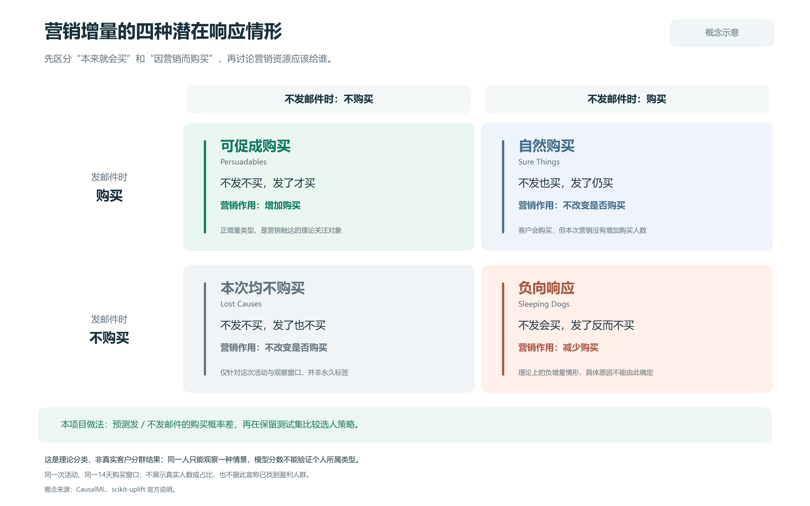
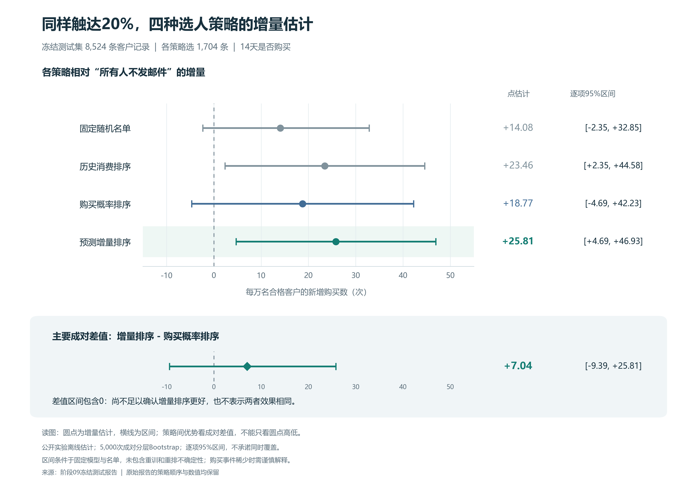
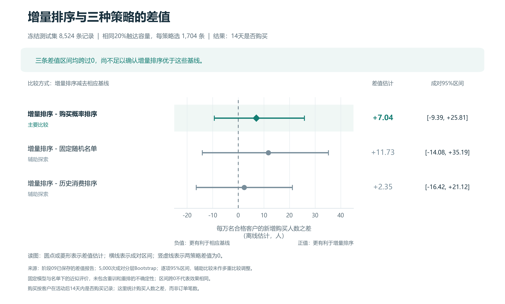
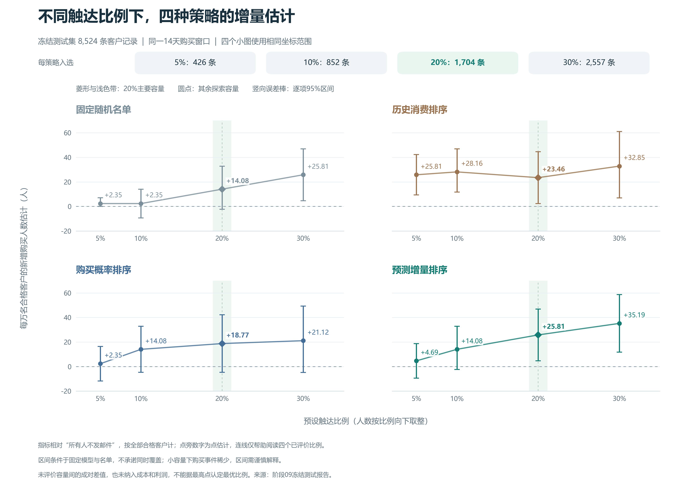

# 营销增量评估与客户触达策略比较

## 📑 目录导航
- [个人背景与项目动机](#个人背景与项目动机)
- [项目亮点](#项目亮点)
- [项目目录](#项目目录)
- [先看结论](#先看结论)
- [数据与方法参考](#数据与方法参考)


**在相同触达容量下，优先联系“更可能被邮件促成购买”的客户，能否比优先联系“购买概率高”的客户带来更多新增购买？**

基于 Hillstrom 公开随机邮件实验的个人学习研究项目。使用经典回归、随机实验评价和配对 Bootstrap，将业务问题连接到客户排序与独立测试；代码、结果表、图表和运行规则均保留。适用于展示营销增量与用户增长策略分析思路。

## 个人背景与项目动机

本人统计学专业，拥有市场方向实习经历。在市场业务实践中发现，营销投放经常直接依据购买概率排序触达客户，忽略营销干预带来的真实增量效应。本项目从该业务痛点出发，结合因果推断、Bootstrap 区间估计等统计学方法，对比两套客户触达排序策略。

## 项目亮点
1. 区分「预测购买概率」和「营销带来的增量效应」，落地真实营销预算分配决策问题；
2. 使用配对Bootstrap计算95%置信区间，不只输出点估计，量化结果统计不确定性，发挥统计学专业优势；
3. 对比两套客户筛选策略，验证增量排序的业务价值，掌握随机A/B实验、Uplift因果推断在营销场景的落地方式；
4. 完整工程链路：数据清洗、建模、协变量平衡校验、离线评估、可视化、结论统计检验，全程规避数据泄露。

Python · pandas · scikit-learn · S-learner · IPW · Bootstrap · Uplift · ATE · Qini

## 项目目录
```
├─ 01_read_and_audit.py     # 数据读取、清洗、EDA 探索性分析
├─ 02_lock_split.py         # 数据集划分，规避数据泄露
├─ 03_train_effect.py       # ITE 个体处理效应估计，S-learner 建模
├─ 04_train_balance.py      # 协变量平衡性检验
├─ 05_train_subgroups.py    # 用户分群，四类响应人群划分
├─ 06_train_bayes.py        # Bayesian uplift 模型
├─ 07_train_ranker.py       # Uplift 排序模型，客户增量排序
├─ 08_validate_policies.py  # 多套营销策略离线评估
├─ 09_final_test.py         # 指标汇总，Qini 曲线、AUUC 计算
├─ 11~14_plot_*.py          # 可视化脚本：Qini 曲线、人群分群、策略收益对比
├─ tools/                   # 通用工具函数
├─ docs/                    # 方法原理、实验日志文档
├─ reports/                 # 实验输出：指标 json、csv、可视化图表
├─ archive_manifest.json
├─ requirements.txt
├─ requirements-lock.txt
└─ README.md
```

## 先看结论

| 要回答的问题 | 保留测试集结果 | 支持的结论 |
|---|---|---|
| 邮件整体是否促成购买？ | 男装邮件减不发邮件：**+0.704 个百分点**；95%区间 **[+0.297, +1.133]** | 本次实验总体平均效果有正向证据 |
| 触达20%时，增量排序是否优于购买概率排序？ | 每万名合格客户的新增购买人数之差：**+7.04**；成对95%区间 **[-9.39, +25.81]** | 尚不足以确认增量排序更优；也不能据此认定两者效果相同 |

两项结论回答不同问题：一次营销活动总体有效，仍需另行验证客户排序模型是否改进了选人决策。

本项目的产出是**可复核的离线策略评价与证据边界**。20%是预设容量情景，未证明为最优比例；结果未换算为利润，未上线投放。

## 业务问题如何变成算法问题

1. **定义结果**：活动后14天是否至少购买一次，记为二元变量 `conversion`。
2. **定义可用信息**：历史消费、距上次购买的月数、新客户标记、历史品类与渠道等实验前特征。
3. **计算两个分数**：在同一个模型中分别设置不发邮件/发邮件，得到 `p0`、`p1`；`p1-p0` 为预测增量分数。
4. **公平比较选人规则**：在同一批客户中，各选 `floor(20% × N)` 人，比较随机、历史消费、`p1`、`p1-p0` 四种排序。
5. **用独立数据评价**：利用实验随机分配估计新增购买，并直接计算策略差值的配对区间。

### 四类潜在响应：解释为什么购买概率与营销增量不同



这是潜在结果的概念图。每位客户只能观察到实际接受的一种处理结果，图中四类不是本项目已经识别出的真实客户分群，也没有估计各类人数。

## 数据与流程

来源为 Kevin Hillstrom 的 MineThatData E-Mail Analytics Challenge。完整公开数据64,000条，主分析保留 **Mens E-Mail 与 No E-Mail 共42,613条**。男装邮件指邮件内容；`mens/womens` 是历史购买品类标记。

| 数据集 | 记录数 | 用途 |
|---|---:|---|
| 训练集 | 25,567 | 总体初步分析、平衡诊断、分层与贝叶斯探索、拟合排序模型 |
| 验证集 | 8,522 | 按冻结规则比较策略，未据点估计宣布赢家 |
| 保留测试集 | 8,524 | 使用相同模型、容量与主比较完成最终评价 |

按实验组分别划分60%/20%/余量，随机种子固定；划分不依据购买结果。特征编码、缩放只在训练集拟合，`visit/conversion/spend` 不作为触达前特征。

```text
原始数据校验 → 冻结划分 → 训练集分析与建模
                            ↓
                     验证集四策略比较
                            ↓
                保持规则 → 保留测试集最终评价
                            ↓
                   图表、限制与下一轮实验建议
```

训练模型为**单个带三项处理交互的 L2 Logistic S-learner**。交互项为距上次购买的月数、历史消费对数、新客户标记。详细设计、估计式和区间定义见 [方法说明](docs/methodology.md)。

训练阶段查看总体结果后新增的分层、贝叶斯和模型设计均保留探索属性；记录设置早于相应计算，不代表整个项目在查看数据前预注册。

## 相同20%容量下，四种策略表现如何

测试集各策略均选1,704条记录。下表的单位是**每万名合格客户的新增购买人数离线估计**，相对“所有人都不发邮件”；分母包括整批合格客户。

| 选人策略 | 点估计 | 逐项95% Bootstrap区间 |
|---|---:|---:|
| 固定随机名单 | +14.08 | [-2.35, +32.85] |
| 历史消费排序 | +23.46 | [+2.35, +44.58] |
| 购买概率排序 `p1` | +18.77 | [-4.69, +42.23] |
| 预测增量排序 `p1-p0` | +25.81 | [+4.69, +46.93] |



图11及早期原始报告将指标写作“购买数（次）”。由于结果是二元购买标记，准确解释应为**购买人数的增量估计**，不能解读为订单数或购买频次；本页已统一使用该口径，原始证据文件按原样归档。

### 主要比较看策略差值



主要比较为增量排序减购买概率排序，估计 **+7.04人/万名合格客户，95%区间[-9.39, +25.81]**。两份名单不同的客户中仅观察到15条购买记录，差值估计仍有较大不确定性。各策略单独区间是否跨0，不能替代策略差值检验。

### 改变触达比例的探索



20%是主要容量；5%、10%、30%为事先记录的探索情景。四个离散容量的比较不等于完整 Qini 曲线，也未评估利润最优容量；本次预测增量排序在所检查的较大容量下点估计更高，不能直接解释为效率更高。原始数值见 [测试集策略表](reports/09_test_policy_results.csv)。

## 如何查看与复现

- **快速阅读**：本页 → [方法说明](docs/methodology.md) → [结论与限制](docs/findings.md)。
- **复画四张图**：已附汇总表和图片，无需原始客户数据；运行根目录11–14脚本。
- **重新运行分析**：先获取并校验公开原始数据，再用 `tools/reproduce.py` 在一个全新目录按顺序执行01–09，保留本次归档证据。

完整步骤、运行环境和已验证范围见 [复现说明](docs/reproduction.md)。Python脚本编号沿用实际操作记录：09为最终评价，10为早期总结文档，11–14为绘图，因此没有10号Python脚本。

```text
README.md                 项目首页
01_*.py … 09_*.py          原始分析脚本（字节保持不变）
11_*.py … 14_*.py          读取汇总结果的绘图脚本
requirements.txt          本机已验证的直接依赖版本
requirements-lock.txt     原运行环境的完整pip freeze快照
tools/                    数据获取、全新目录复现、归档校验
data/raw/                 来源说明与原始数据校验信息
reports/                  汇总结果与冻结设置记录
reports/figures/           四张图、SVG及读图说明
docs/                     方法、结论、复现、历史过程记录
```

公开快照保留代码、汇总结果与图表；原始CSV、逐行分数与名单、模型文件由本地复现生成。原始数据的取得和使用遵循原发布来源条件；本仓库未为数据另行声明授权。

## 项目边界与贡献记录

本项目采用公开历史实验和经典方法，重点是把营销问题、模型分数、决策比较和不确定性连起来。没有真实CRM身份、投放成本与利润数据；四类响应图是概念示意。

项目使用AI辅助实现脚本、调试、审阅与文档整理，作者按步骤在本地运行、记录结果并学习解释；原始过程见 [学习实验日志](docs/history/experiment_log.md)。本仓库展示可检查的项目产物，个人职责与掌握程度应按实际情况陈述。

后续工作应先明确成本和有业务意义的最小增量，再在新样本中随机比较候选策略。当前保留测试集已用于最终评价，新增模型需要新的独立评价数据。

## 数据与方法参考
- [数据集来源：MineThatData E-Mail Analytics Challenge（Hillstrom邮件营销实验数据）](https://blog.minethatdata.com/2008/03/minethatdata-e-mail-analytics-and-data.html)
- [TensorFlow Datasets Hillstrom数据集文档](https://www.tensorflow.org/datasets/catalog/hillstrom)
- [scikit-uplift：Hillstrom数据集加载示例](https://www.uplift-modeling.com/en/latest/api/datasets/fetch_hillstrom.html)
- [scikit-uplift：Uplift潜在响应类型说明](https://www.uplift-modeling.com/en/v0.3.1/user_guide/introduction/clients.html)
